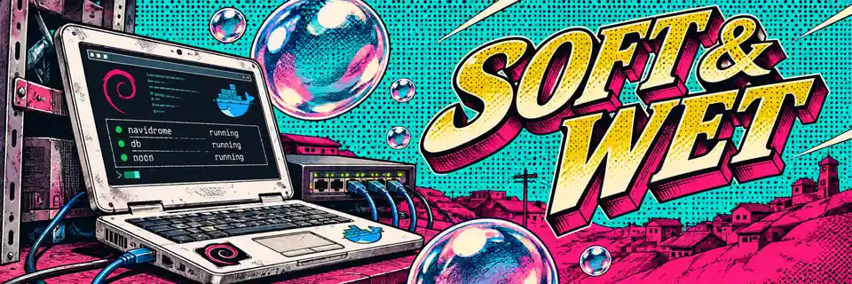

# Soft & Wet

**A real home server built from a nearly obsolete laptop.**

 [&color=229953&style=flat-square&labelColor=161B22)](README.pt-BR.md)  

    

       

      

    

*Badges link to upstream projects; actual installation states are tracked in the [service registry](docs/services/README.md).*

---

## The experiment

I had a Positivo notebook with **2 GB of RAM**, an Intel Atom processor and roughly **29 GB of internal eMMC**. No spare server, no NAS, no room for heavy virtualization, and no reason to leave another computer occupying my desk.

Instead of discarding it, I installed **Debian 13 without a graphical environment**, moved it to another room, and started running useful services that I could operate remotely from my main Ubuntu PC and my phone.

**The project is about making limited hardware genuinely useful.** Containers, streaming and remote access are ways of testing that idea—not the purpose of the repository. I want to understand the host, measure what each service costs, troubleshoot failures, document the trade-offs, and expand only when the hardware can handle it.

The name and artwork take inspiration from *JoJolion*. Like the early experiments, this homelab starts small and leaves room for the unexpected.

## The three devices

| Role | Machine | Important specifications |
|---|---|---|
| **Server — Soft & Wet** | Positivo notebook | Intel Atom x5-Z8350 · **2 GB RAM** · ~29 GB internal eMMC · **Debian 13**, headless |
| **Administration / file source** | Ubuntu desktop | **Intel Core i7-3770 (4 cores / 8 threads)** · **Intel HD Graphics 4000** · ~16 GB RAM · Ubuntu **26.04.1 LTS** · GNOME 50.1 / Wayland |
| **Remote mobile client** | Samsung Galaxy A34 5G | **6 GB RAM / 128 GB storage** · 6.6″ Super AMOLED 120 Hz · 5G · 5,000 mAh battery |

The desktop is **not** the server; it provides SSH administration, file transfer and browser-based access. The Android phone is a remote client. Full, source-annotated specifications—including the desktop's kernel and disk snapshot—are in [hardware inventory](docs/hardware.md).

## What I actually did

| Milestone | Implementation | Evidence |
|---|---|---|
| Installed a minimal OS | Debian 13, no desktop environment | Server operational over SSH from another room |
| Set up remote administration | OpenSSH and standard Linux tools | Managed from Ubuntu |
| Introduced containers | Docker Engine + Compose | v5.8.0 reported; one service running |
| Validated a real workload | Navidrome and ten locally stored songs | Browser playback/library confirmed |
| Tested remote access | Tailscale on Debian and Android | Streaming outside home network confirmed |
| Captured a baseline | `df`, `free`, `swapon`, `docker stats` | 23G free before apps; 388 MiB host RAM used |

Only **one application container** was deployed at the first milestone. **Portainer, Pi-hole, monitoring, dashboards and other tools are part of the intended ecosystem, not a claim that they are already installed.** See the [service registry](docs/services/README.md) for their individual states.

## How the lab is connected

~~~text
                        HOME NETWORK
┌────────────────────────┐      SSH, rsync, HTTP    ┌───────────────────────────┐
│ Ubuntu desktop         │◄───────────────────────►│ Positivo notebook          │
│ i7-3770 / GNOME        │                          │ Debian 13 · 2 GB RAM      │
│ operations + media     │                          │ Docker Engine + Compose   │
└────────────────────────┘                          │ OpenSSH · Tailscale       │
                                                    │ internal eMMC only       │
                                                    └────────────┬──────────────┘
                                                                 │ private tailnet
                                                                 ▼
                                                    ┌───────────────────────────┐
                                                    │ Samsung Galaxy A34 5G     │
                                                    │ mobile access / playback  │
                                                    └───────────────────────────┘
~~~

No Internet-facing port forwarding is needed for the tested remote playback. Container port **4533** is currently published on all host interfaces by Docker; network hardening remains open, and Tailscale does not silently solve that.

## Resource budget

| Baseline / first observation | Recorded result |
|---|---|
| Root filesystem before app deployment | 27G total · 2.0G used · **23G available** |
| Host RAM before app deployment | ~1.8 GiB visible · **388 MiB used** · ~1.4 GiB available |
| Swap | 1.5 GiB partition · 0 B used |
| First Navidrome container reading | **32.51 MiB RAM** · 15.83% CPU at startup (one instant) |
| External storage | **None** — USB Ventoy idea rejected for permanent operation |

That one container reading is **not** a long-term benchmark. Media, metadata and logs all compete with the system for the same internal space. I measure before adding more software.

## Reproduce and understand

For a Debian host that already has Docker Engine and Compose:

~~~bash
git clone https://github.com/kayo-willian/soft-and-wet-homelab.git
cd soft-and-wet-homelab
mkdir -p data/navidrome music
printf 'HOST_UID=%s\nHOST_GID=%s\n' "$(id -u)" "$(id -g)" > .env
sudo docker compose config
sudo docker compose up -d
sudo docker compose ps
~~~

This recreates **the first documented service**, not an imaginary complete stack. The server's original working directory was `~/soft-and-wet`. The Compose file still reflects the first deployed configuration; the later security improvements and extra services have not been applied.

## Technical documentation

| Area | English | Português |
|---|---|---|
| Navigation | [Documentation index](docs/README.md) | [Índice técnico](docs/pt-BR/README.md) |
| Physical devices | [Hardware inventory](docs/hardware.md) | [Inventário](docs/pt-BR/hardware.md) |
| Host architecture | [Architecture](docs/architecture.md) | [Arquitetura](docs/pt-BR/architecture.md) |
| Install and reproduce | [Installation](docs/installation.md) | [Instalação](docs/pt-BR/installation.md) |
| Services and containers | [Service registry](docs/services/README.md) | [Serviços](docs/pt-BR/services/README.md) |
| Network | [Network and remote access](docs/networking.md) | [Redes](docs/pt-BR/networking.md) |
| Operations | [Maintenance and backup](docs/operations.md) | [Operação](docs/pt-BR/operations.md) |
| Security | [Security boundaries](docs/security.md) | [Segurança](docs/pt-BR/security.md) |
| Measurements | [Real measurements](docs/measurements.md) | [Medições](docs/pt-BR/measurements.md) |
| Media catalog | [Brasil collection](docs/music-library.md) | [Biblioteca Brasil](docs/pt-BR/music-library.md) |
| Failures and decisions | [Troubleshooting](docs/troubleshooting.md) | [Solução de problemas](docs/pt-BR/troubleshooting.md) |

The detailed pages explain the *why*, *commands used*, *results actually observed* and *remaining limitations*. The files avoid distributing passwords, music, user databases, private IP/MAC addresses or other local data.

## What comes next?

This is still the beginning. The public names belong to a larger, deliberately unrevealed sequence:

**SOFT & WET**  
↓  
**PLUNDER**  
↓  
**SOFT & WET · V2**  
↓  
**SOFT & WET · V3**  
↓  
**GO BEYOND**  
↓  
**MADE IN HEAVEN**

*Some stages may never happen. The details stay hidden until there is something real to show.*

## Scope and license

This is a personal technical project—not a software product, commercial service or enterprise environment. No VM, no permanent removable drive, no movie download automation, and no claims of tested backups, hardened public exposure or availability guarantees.

The [MIT license](LICENSE) covers this repository's original documentation and configuration, not third-party software or music files.
